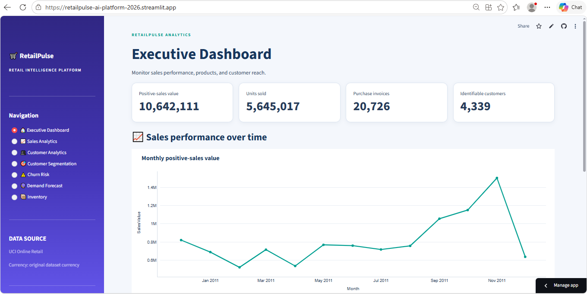
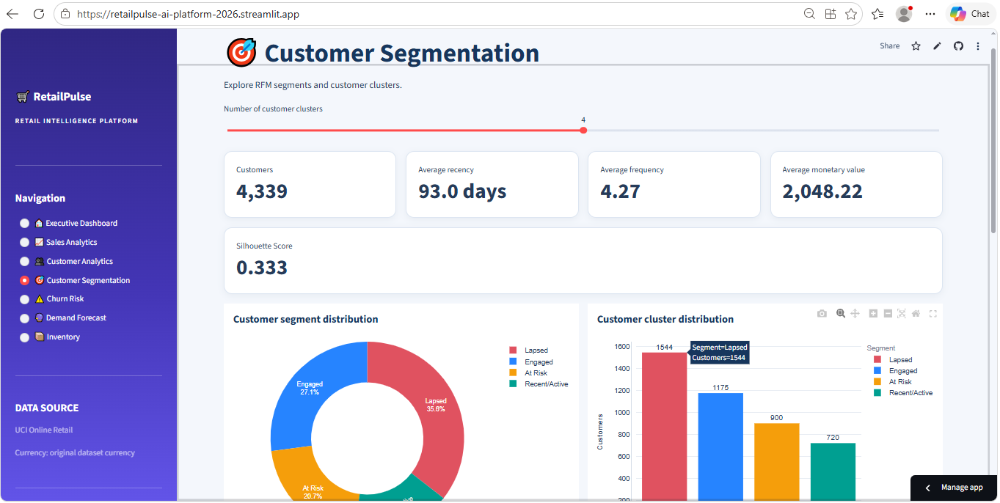
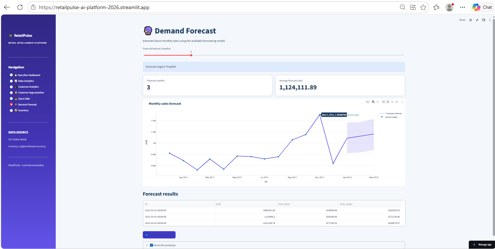

# RetailPulse – AI-Powered Customer Analytics & Demand Forecasting Platform

RetailPulse is an end-to-end retail analytics platform designed to transform historical transaction data into meaningful business insights. It combines sales analysis, customer behaviour analysis, customer segmentation, customer inactivity-risk identification, demand forecasting, and inventory optimization in an interactive dashboard.

This project was developed as part of the **Zidio Development Data Science & Analytics Internship**.

**Live Dashboard:** https://retailpulse-ai-platform-2026.streamlit.app

**GitHub Repository:** https://github.com/arshinsheikh27-eng/RetailPulse-AI-Customer-Analytics

---

## Project Team

| Team Member | Responsibilities |
|---|---|
| **Arshin Sheikh** | Data inspection and preparation, data cleaning pipeline, exploratory data analysis (EDA), sales visualizations, customer-level RFM feature engineering, validation, and data documentation. |
| **Pavithra Korivipalli** | Streamlit dashboard development, FastAPI backend, customer segmentation, churn/inactivity-risk analysis, demand forecasting, inventory optimization, and application integration/configuration. |

The project was completed collaboratively. Both team members contributed their assigned modules, which were integrated into the final application.

---

## Dashboard Preview

### 1. Executive Dashboard

Provides an overview of retail performance through key business indicators and sales visualizations.



### 2. Customer Segmentation

Groups customers based on their purchasing behaviour and customer-level features.



### 3. Demand Forecast

Displays historical monthly sales and estimated future sales.



---

## Key Features

- **Executive Dashboard:** Presents high-level business KPIs and an overview of retail performance.
- **Sales Analytics:** Explores monthly sales trends and product- and country-level sales patterns.
- **Customer Analytics:** Summarizes customer purchasing behaviour using customer-level analytical features.
- **Customer Segmentation:** Uses clustering techniques to identify customer groups with similar purchasing characteristics.
- **Churn / Inactivity-Risk Analysis:** Identifies customers whose purchase recency exceeds a configurable inactivity threshold. This is a rule-based risk indicator, not a trained churn-classification model.
- **Demand Forecasting:** Generates monthly sales estimates using Prophet, with a linear-trend fallback if Prophet cannot produce a forecast.
- **Inventory Optimization:** Provides inventory-related analysis and recommendations to support stock-planning decisions.

---

## Technology Stack

| Category | Technologies |
|---|---|
| Programming Language | Python |
| Data Processing | Pandas, NumPy |
| Data Visualization | Plotly, Matplotlib, Seaborn |
| Machine Learning | Scikit-learn |
| Demand Forecasting | Prophet |
| Dashboard | Streamlit |
| API Development | FastAPI, Uvicorn |
| Testing | Pytest |
| Version Control | Git, GitHub |

---

## Dataset and Data Preparation

The project uses historical online retail transaction data. The processed dataset contains approximately **536,641 transaction rows** and **21 columns**.

The data preparation workflow includes:

- Inspecting the source transaction data.
- Cleaning and preparing records for analysis.
- Performing exploratory data analysis (EDA).
- Generating sales and product-level visualizations.
- Engineering customer-level features, including RFM-style measures:
  - Recency
  - Frequency
  - Monetary Value
- Preparing analytical datasets for the dashboard and downstream modules.

For further details, refer to the data dictionary, cleaning methodology, and analysis documents in the `docs/` directory.

---

## Project Structure

```text
RetailPulse-AI-Customer-Analytics/
│
├── .github/                # GitHub workflow/configuration files
├── api/                    # FastAPI application
├── data/
│   └── processed/          # Processed retail dataset
├── docs/
│   ├── images/             # Dashboard screenshots
│   ├── data_dictionary.md
│   ├── data_cleaning_methodology.md
│   └── Other analysis documentation and EDA outputs
├── notebooks/              # Exploratory analysis notebooks
├── reports/                # Generated analytical summaries
├── scripts/                # Utility scripts
├── src/                    # Data preparation and analytics modules
├── tests/                  # Automated tests
│
├── app.py                  # Streamlit dashboard entry point
├── Dockerfile              # Container configuration
├── requirements.txt        # Python dependencies
├── run_api.bat             # API startup helper
├── run_dashboard.bat       # Dashboard startup helper
├── run_tests.bat           # Test runner
└── setup.bat               # Windows setup helper
```

---

## Installation and Local Setup

### 1. Clone the Repository

```bash
git clone https://github.com/arshinsheikh27-eng/RetailPulse-AI-Customer-Analytics.git

cd RetailPulse-AI-Customer-Analytics
```

### 2. Create a Virtual Environment

For Windows PowerShell:

```powershell
python -m venv .venv

.venv\Scripts\Activate.ps1
```

### 3. Install Dependencies

```bash
python -m pip install --upgrade pip

pip install -r requirements.txt
```

### 4. Run the Streamlit Dashboard

```bash
streamlit run app.py
```

Open the local URL displayed in the terminal. Streamlit commonly uses:

`http://localhost:8501`

### 5. Run the FastAPI Service (Optional)

Open a separate terminal, activate the virtual environment, and execute:

```bash
uvicorn api.main:app --reload
```

The interactive API documentation will be available at:

`http://127.0.0.1:8000/docs`

### 6. Run Tests

```bash
python -m pytest -q
```

---

## API Endpoints

The project includes a FastAPI service for local API access and demonstration.

| Method | Endpoint | Description |
|---|---|---|
| GET | `/health` | Checks API health |
| GET | `/summary` | Returns an overall retail summary |
| GET | `/sales/monthly` | Returns monthly sales data |
| GET | `/customers/segments` | Returns customer segmentation results |
| GET | `/customers/churn-risk` | Returns customer inactivity-risk results |
| GET | `/forecast` | Returns sales forecast results |

**Deployment Note:** The public demo link provided above is the Streamlit dashboard. The FastAPI service is locally runnable and is not presented as a separately deployed public service.

---

## Testing

The project includes automated tests using Pytest.

To execute the test suite, run:

```bash
python -m pytest -q
```

The latest project test run completed successfully with **3 tests passing**.

---

## Results, Scope and Limitations

- The processed transaction dataset contains approximately 536,641 rows.
- The platform integrates sales, customer, segmentation, inactivity-risk, forecasting, and inventory analysis into one dashboard.
- The churn-risk module uses purchase recency and a configurable inactivity threshold as a proxy for customer inactivity risk. It should not be interpreted as a trained churn prediction model.
- Demand forecasting is based on a limited historical period. Forecast values are estimates for planning and demonstration purposes, not guaranteed outcomes.
- No forecast-accuracy claim is made without proper time-based validation.
- Inventory recommendations are decision-support outputs and should be reviewed alongside actual stock levels, supplier lead times, and operational constraints.

---

## Future Improvements

- Perform time-based backtesting and evaluate forecasting performance using suitable error metrics.
- Develop and validate a supervised churn prediction model using labelled customer outcomes.
- Integrate live inventory levels, supplier lead times, and replenishment constraints.
- Expand automated model monitoring and deployment workflows.

---

## Acknowledgement

We sincerely thank **Zidio Development** for providing the opportunity to work on this Data Science & Analytics internship project.

---

